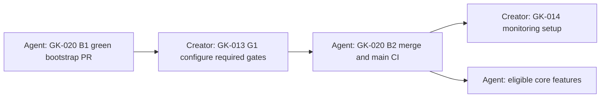

# Start here: how we work through the GK Cakes tickets

[Two-person role split: developer English / business owner Ukrainian](docs/roles/README.md)
is the current responsibility guide. Sasha is the developer; a separate business
owner supplies business decisions/content and reviews the product. The original
**Creator** label combined both humans. Below, “you” means the person performing
the relevant human contribution; use the role packets to identify that person.
**Agent** means Codex executes assigned design/implementation work. The business
owner need not edit code or technical specifications. Unclear choices stay undecided.

The [Trello board](https://trello.com/b/QEjqyM9i) is the live work list. This guide
explains the published plan; it does not claim every card is currently Ready.
[SETUP](SETUP.md) has the detailed account instructions; [PLAN](docs/design/PLAN.md)
has the technical design and dependency graph. No application work starts merely
because you supply a Creator answer.

## What to do first

1. Open a Ready card labelled **Owner: Creator**. Start with GK-001 if you want
   to follow the suggested order. You can supply the GK-002 logo/photos immediately
   too; you do not need to finish the other policy cards first.
2. Read its “To dos” and “Acceptance Criteria”. Ask Codex to translate them into
   a short checklist or ask you the questions one at a time.
3. Put your answers and asset references on that same card using the template below.
   Partial answers are useful: clearly distinguish approved answers from ideas
   and open questions. Do not invent missing values to finish a card.
4. Tell the planning agent the card ID/link and ask it to process your handoff.
   A Trello edit by itself does not wake an agent or automatically download assets.
5. The agent reads your result, checks access to files, summarizes what it understood,
   saves the usable approved input in this checkout, and identifies any gaps.
   When the card's criteria are met, you explicitly accept the result/Done transition.
6. The planning agent checks affected prerequisites and reviews any changed contracts
   before making a dependent Agent card Ready. A “Done” predecessor alone does not
   prove all other prerequisites are ready.

The initial decision/content order is **GK-001 → GK-003 → GK-004 → GK-005 →
GK-006 → GK-007 → GK-002**. These seven can collect information independently;
the order is a helpful default, not a requirement to wait for every earlier answer.
GK-015 design exploration can become eligible after GK-002 alone; GK-019 needs
approved GK-001/003/004/005/006/007 outputs. Neither requires you to set up every
candidate service.

## Where your answers and assets go

**Simplest route: use the matching Trello card.** Add a result comment with your
answers and attach the logo/photos/documents there, or link a folder the agent can
actually access. Keep the card description's implementation requirements intact.
Identify which exact files are approved for use. For large photo collections, use
an accessible folder and link individual chosen originals in your result.

You can also send answers/files in this Codex task: begin with **“For GK-002…”**
(or the appropriate ID) and ask the agent to save them and update that card. You do
not have to fill Markdown files yourself. Chat is an intake method; before a later
agent relies on it, the result must be saved and linked to the ticket.

| Information | Human submission | Where the agent records usable input |
| --- | --- | --- |
| Business decision or finding | Card comment with answer, source/date and approval status | `docs/creator/GK-NNN/README.md`; approved current rules consolidated into `docs/design/creator-decisions.md` and affected contracts/ADRs |
| Original logo and selected cake photos | Attach to GK-002, link an accessible folder, or attach here with the ticket ID | `docs/creator/GK-002/assets/`; inventory in that ticket's README with original source, purpose, usage approval and exact filename/version |
| Product/recipe/allergen content | Attach a document/spreadsheet or write a table on the relevant card | That Creator ticket's folder, preserving your original and an agent-readable summary; unresolved content stays flagged |
| Provider/account setup evidence | Safe resource IDs, chosen plan/region, setting names, dated verification result | Corresponding Creator ticket folder and relevant SETUP instructions; access tested again when used |
| Visual feedback/approval | Comment on the Agent design card, naming the exact sketch revision | `docs/design/sessions/<flow>/` with source/previews/feedback and the exact approval reference |
| Passwords, API keys, recovery codes, bank/identity verification documents | Keep in the provider or approved secure store, not chat/Trello/Git | Record only a safe setting/secret name, owner and storage location, never its value |

The [Creator input folder](docs/creator/README.md) is ready; the [asset intake folder](docs/creator/GK-002/assets/README.md)
contains instructions, not supplied branding. The agent creates other ticket folders
when material arrives. Preserve originals; name replacements clearly rather than
overwriting an approved file. Large/private originals can stay in their approved
source location with an access-checked reference instead of being committed to Git.
Files saved only on this Mac are not automatically available to another checkout,
cloud task or machine: the receiving agent must verify access before it starts.

## Copy this when you finish or update a Creator card

```text
Creator handoff — GK-NNN — revision r1 — date:
Status: Partial / Ready for review

Approved decisions:
- [what I have actually chosen]

Findings/evidence:
- [source link or document, date checked, what it establishes]

Assets:
- [attachment/file link; what it is; exact filename/version;
   original or revised; approved for which use; ownership/permission]

Still undecided / missing:
- [question or missing item; write “none” only if none remain]

Replaces:
- [previous revision, or “first submission”]

Please check against this card's acceptance criteria, summarize your understanding,
save the approved input, and tell me what becomes unblocked. Do not implement code.
```

You can mark some decisions approved while the overall result is Partial. An
exploration image or “I like this direction” is not approval of every screen.
For design approval, use a precise statement such as **“I approve GK-015 revision
v02, the desktop and mobile previews linked in this card.”** Do not use that example
until you have actually reviewed and accepted those files.

If you change your mind later, post a new dated revision saying what it replaces.
The agent retains the earlier evidence, updates the current decision and invalidates
only affected designs/tickets. Conflicting statements are clarified, not silently
resolved by taking the latest casual comment as approval.

## How to read the ticket names

`[GK-021][P0][O190][W05] ...` means:

- **GK-021:** permanent ticket identity, not its place in the sequence.
- **O190:** suggested position in the combined Creator + Agent work queue.
- **W05:** dependency stage, not a calendar week or deadline.
- **P0/P1:** priority; it never bypasses a prerequisite.

Choose the lowest-O eligible card, regardless of owner. Check its “Depends on”
links and required output before starting. If it is blocked, work on another
eligible independent card. A smaller O on an unrelated card does not block you.
Cards in different Trello lists are not one automatically combined visual queue;
the table below puts both owners together. Live readiness still comes from Trello.

## Complete combined order

Rows follow the published O numbers. “Agent + your review” still means Owner: Agent.
The extra GK-020 resume row is the same ticket, not a new card. This table describes
handoffs, not authorization to begin implementation or release now.

| O | Who acts | Ticket | Work and handoff |
| --- | --- | --- | --- |
| 010 | Human — see role split | [GK-001](https://trello.com/c/eI8UpD6l/16-gk-001p0o010w00-set-production-pickup-and-london-delivery-policy) | Write your production, pickup and delivery rules; identify anything undecided. |
| 020 | Human — see role split | [GK-003](https://trello.com/c/ftGtoGNB/17-gk-003p0o020w00-approve-customer-agreement-accounts-and-refund-policy) | Approve customer/quote/account/cancellation/refund rules. |
| 030 | Human — see role split | [GK-004](https://trello.com/c/RotJkR9L/18-gk-004p0o030w00-select-provider-package-and-recovery-budget) | Choose one provider package and dated budget; set recovery expectations. |
| 040 | Human — see role split | [GK-005](https://trello.com/c/OWHhKPBT/19-gk-005p0o040w00-verify-uk-business-allergen-tax-and-privacy-content) | Supply verified business, allergen, tax and privacy wording/evidence. |
| 050 | Human — see role split | [GK-006](https://trello.com/c/npWFafNi/20-gk-006p0o050w00-confirm-release-only-deployment-and-repository-access-policy) | Confirm who may approve releases and the required review/merge policy. |
| 060 | Human — see role split | [GK-007](https://trello.com/c/iJqMyuN1/21-gk-007p0o060w00-set-discounts-recipe-scaling-and-ingredient-accounting-rules) | Supply discount, recipe, stock-use and grocery-cost examples. |
| 070 | Human — see role split | [GK-002](https://trello.com/c/JsXtAhB2/22-gk-002p1o070w00-supply-brand-and-cake-content-for-chrome-visual-exploration) | Supply original logo, cake photos and product information with usage approval. |
| 080 | Human — see role split | [GK-010](https://trello.com/c/5AdmfDVH/23-gk-010p0o080w01-provision-selected-data-identity-and-storage-sandbox) | Create only selected data/auth/storage resources; return resource IDs and verified first-manager identity, not secrets. |
| 090 | Human — see role split | [GK-011](https://trello.com/c/ZhcwMqTc/24-gk-011p0o090w01-provision-selected-payment-and-email-test-accounts) | Set up selected payment/email test accounts; return safe configuration evidence. |
| 100 | Agent | [GK-019](https://trello.com/c/lW3wuYq0/25-gk-019p0o100w01-reconcile-approved-policies-into-executable-contracts) | Agent turns approved Creator answers into precise shared rules and refreshes affected tickets. |
| 110 | Human — see role split | [GK-012](https://trello.com/c/nveiC5IF/26-gk-012p1o110w01-verify-domain-instagram-ownership-and-approved-origins) | Verify the domain and Instagram account; return ownership/approved-origin evidence. |
| 120 | Agent + business-owner review | [GK-015](https://trello.com/c/POD3I6sM/27-gk-015p1o120w01-approve-chrome-led-visual-foundation-with-the-creator) | Agent shows logo/colour/layout options; you approve an exact visual revision. |
| 130 | Agent + business-owner review | [GK-017](https://trello.com/c/1YGOcOHR/28-gk-017p0o130w02-review-checkout-and-order-recovery-sketches) | Agent shows checkout/order/recovery flows; you review and approve the chosen revision. |
| 140 | Agent | [GK-020](https://trello.com/c/W8q5svCh/29-gk-020p0o140w02-bootstrap-separately-buildable-ui-and-transactional-api) | Agent prepares bootstrap PR, working checks and exact check names (B1); pauses before finishing. |
| 150 | Agent + business-owner review | [GK-016](https://trello.com/c/oapKvUNJ/30-gk-016p1o150w02-review-discovery-bespoke-and-account-flow-sketches) | Agent shows discovery/custom-request/account flows; you review and approve the revision. |
| 160 | Agent + business-owner review | [GK-018](https://trello.com/c/jjP7btz9/31-gk-018p1o160w02-review-daily-chef-operations-sketches) | Agent shows daily chef workflows; you review and approve the revision. |
| 170 | Human — see role split | [GK-013](https://trello.com/c/KpxlodVh/32-gk-013p0o170w03-configure-required-ci-review-and-native-auto-merge-gates) | Using B1 check names, configure required GitHub checks/reviews and native auto-merge availability (G1). |
| Resume 140 | Agent | [GK-020 B2](https://trello.com/c/W8q5svCh/29-gk-020p0o140w02-bootstrap-separately-buildable-ui-and-transactional-api) | After your GK-013 G1 evidence, recheck the bootstrap PR, use required checks/review and native auto-merge, verify main CI, then request your acceptance. |
| 180 | Human — see role split | [GK-014](https://trello.com/c/47tZfEoI/33-gk-014p0o180w05-configure-monitoring-and-verify-restore-ownership) | Set monitoring/backup ownership and approved recovery targets; return safe settings evidence. |
| 190 | Agent | [GK-021](https://trello.com/c/zEfCJtWD/34-gk-021p0o190w05-authorize-customers-staff-and-safe-historical-claims) | Implement and verify customer/staff access; you may need to enter exact provider callback settings supplied by the agent. |
| 200 | Agent | [GK-024](https://trello.com/c/J6zlPAc9/35-gk-024p0o200w05-deliver-durable-transactional-email-and-evidence) | Implement durable transactional emails and delivery evidence. |
| 210 | Agent | [GK-022](https://trello.com/c/tcV2Ilpz/36-gk-022p0o210w06-publish-cake-catalog-variants-and-recipe-history) | Implement cake catalogue, variants and recipe/image history. |
| 220 | Agent | [GK-023](https://trello.com/c/NHHBokl1/37-gk-023p0o220w06-reserve-production-ready-stock-and-pickup-independently) | Implement separate production, ready-stock and pickup capacity. |
| 230 | Agent | [GK-034](https://trello.com/c/L9d2rl39/38-gk-034p0o230w06-build-verified-independent-component-release-pipelines) | Implement independent UI/backend release tooling and infrastructure recovery checks; no production release implied. |
| 240 | Agent | [GK-025](https://trello.com/c/vyFTtISc/39-gk-025p0o240w07-collect-full-payment-with-safe-holds-and-discounts) | Implement full payment, reservations, discounts and late-payment recovery. |
| 250 | Agent | [GK-028](https://trello.com/c/t4HD6N0Z/40-gk-028p1o250w07-deliver-appetising-discovery-and-public-availability) | Implement approved discovery screens and public availability. |
| 260 | Agent | [GK-026](https://trello.com/c/xiEN4jvp/41-gk-026p0o260w08-cancel-and-refund-safely-across-production-races) | Implement cancellation/refunds and production-start race protection. |
| 270 | Agent | [GK-027](https://trello.com/c/G8hLmSBU/42-gk-027p1o270w08-convert-bespoke-agreements-and-manual-orders-to-payment) | Implement bespoke/manual agreement to payment, reorder logic and preserved inspiration images. |
| 280 | Agent | [GK-031](https://trello.com/c/6moC1CyN/43-gk-031p0o280w09-run-chef-fulfillment-and-atomic-pickup-changes) | Implement daily chef fulfillment and pickup changes. |
| 290 | Agent | [GK-029](https://trello.com/c/VLFYxaee/44-gk-029p1o290w09-deliver-account-history-favourites-and-profile-ui) | Implement account history, favourites and profile screens. |
| 300 | Agent | [GK-033](https://trello.com/c/3YbFGdmp/45-gk-033p1o300w09-expose-email-recovery-audit-and-business-metrics-to-chef) | Implement chef email recovery, audit and business reports. |
| 310 | Agent | [GK-030](https://trello.com/c/BkYDridR/46-gk-030p0o310w10-deliver-checkout-order-timeline-and-refund-recovery-ui) | Implement checkout and order/refund progress screens. |
| 320 | Agent | [GK-032](https://trello.com/c/lRzYGTEM/47-gk-032p1o320w10-track-fridge-ingredients-and-grocery-budget-by-date) | Implement ingredient inventory and grocery planning. |
| 330 | Agent | [GK-035](https://trello.com/c/qtUe3uom/48-gk-035p0o330w11-verify-complete-customer-and-chef-launch-scenarios) | Run complete customer/chef scenarios and integrated restore checks; you assess the results. |
| 340 | Human — see role split | [GK-036](https://trello.com/c/Dtl6mdxP/49-gk-036p0o340w12-authorize-the-first-production-component-release) | Approve or decline one exact production release after launch evidence; this is separate release authorization. |

The important return handoff is:



GK-020 stays in Review at B1; do not mark it Done before G1/B2. GK-013 can finish
its configuration deliverable without waiting for that merge. All other GK-020
dependents require B2. This avoids waiting for each other forever.

Only these Agent pairs are currently scoped for parallel work: **GK-021 + GK-024**
and **GK-028 + GK-034**, after each card's own prerequisites and disjoint file
ownership checks. Same wave does not mean every card can run simultaneously.
Design sessions involve you even while backend work proceeds independently.

## What happens to the card status

**Backlog** means a decision, design or other prerequisite is missing. **Ready**
means its own start criteria are satisfied. **In Progress** means someone is doing
it. **Review** means the result/evidence needs checking or your acceptance. **Done**
requires the board's explicit acceptance rule. Use the Blocked label with the
specific missing input; the agent must not invent your approval or move a card to
Done because files were merely uploaded. You may update your own card; when asking
an agent to change statuses, name the allowed cards/action.

## Ready-to-use messages for Codex

To work through a Creator card without technical jargon:

> Help me complete GK-001. Read its live Trello card and current approved decisions.
> Ask the remaining questions one at a time in plain English and explain the options.
> Do not implement code or register services.

To hand over your result and authorize its recording:

> Use $gk-plan to process my Creator handoff for GK-NNN at [card/file link]. Read its
> comments and attachments; save approved inputs under docs/creator/GK-NNN and link
> them on that existing card. Summarize what you understood, update affected planning
> artifacts/tickets within this scope, and report gaps. Do not implement code,
> register services or mark Done without my explicit acceptance.

To find the next work across both owners:

> Use $gk-plan to check the live board and latest approved handoffs. Tell me the next
> eligible Creator ticket and next eligible Agent ticket in O order, their inputs,
> and any blockers. Do not start application implementation.

The agent checks the latest card/evidence, confirms file access and exact approved
revisions, imports/records the handoff, refreshes affected shared decisions, and
applies the model/context and review gates before dependent work. GK-019 is the
initial cross-policy reconciliation; later changes are handled on affected tickets,
not by restarting the whole planning exercise. Model IDs/hashes are the agent's
recordkeeping responsibility, not a worksheet you must fill in.
