# GK Cakes planning index — r5, 2026-09-21

## Current bounded reconciliation — GK-019 / 2026-10-06

Use [GK-019 input/model check](gk019/input-manifest.json),
[contracts r6.5](contracts.md), [owner-data-contract gk019-owner-r7](owner-data-contract.md),
[schema](gk019/schema.json), [decisions](creator-decisions.md),
[exact amendment drafts](gk019/amendments/README.md), and
[GK-015 handoff](gk019/GK-015-handoff.md). Historical records below are retained,
not a current readiness or approval claim.

Current Trello prerequisites were read live; GK-001/003/004/005/006/007 and
GK-010/011/012 are Done for recorded scoped inputs. GK-019 remains Backlog.
Local contracts are reviewed separately; no status/write or application work
authorized by this run. Current evidence and final findings are in
[GK-019 review](gk019/review.md). [Questions](gk019/questions.md) remain one-at-a-time;
Q1 accepted (Sasha Yes): scoped chef-approved ready/resale shorter lead, original handover retained. Q2 accepted: late-paid feasibility/customer agreement or full return; Q3 accepted consented basic analytics; Q5 verified alternative return and Q4 optional currency accepted; current Onelink bundle accepted subject to GBP compatibility; visible slot choices required for pickup/delivery, no repeated Check. Implementation qualification continues; no unanswered business question on current evidence. Independent reviewer astra/xhigh requested-only,
fork_turns=none; author astra/high confirmed by host turn_context.

GK-015 owns its visual artifacts; this context owns contracts/canonical intake/ADRs.
No edits to sessions/screens. Existing staged/untracked work is preserved.
GK-037 remains after GK-035 before GK-036; GK-038 gates affected validated data
for GK-022/032, without adding a false blanket implementation dependency.

## Live scope amendment — 2026-10-05

[GK-037](tickets/GK-037.md) ([Trello](https://trello.com/c/Zarzv2Qo)) is the separate
Creator-owned prelaunch legal/privacy/product-label gate. GK-005 and BO-GK-005
completed the approved business-input stage. Dependencies now include
**GK-035 → GK-037 → GK-036**; implementation and sandbox acceptance do not wait
for GK-037. Other prerequisites remain. GK-019 must reconcile the
[GK-005 interview](../creator/GK-005/interview-2026-10-05.md) before affected implementation.
The [closure receipt](../creator/GK-005/closure-publication-2026-10-05.json) records live
Trello changes. Earlier generated ticket maps/bodies remain historical publication snapshots;
apply this amendment with them rather than assuming the old graph is current.

Current GK-001 handover: [manual-handover-r2](../creator/GK-001/handover.md),
[exact revision/review receipt](../creator/GK-001/handover.json). Source/decision
updates preserve explicit user replies: both-cake original 120-hour refund deadline,
100%/exact50% boundary and chef100%; 192-hour minimum; uncertain dates personally
resolved by chef/admin; accepted orders survive capacity reduction. See the receipt
for actual GK-001 publication/Done evidence. Do not mark dependents Ready from a
handover alone; GK-019 still needs its other policy prerequisites and integration.

Current GK-003 input: [manual handover](../creator/GK-003/handover.md) and
[manifest](../creator/GK-003/handover.json) supply website/template payments within
24 hours and separate GK delivery collections/refunds. Its status and review remain
in its own receipt; use both packets for GK-019 rather than mixing prior snapshots.

## Current intake follow-up — 2026-10-04

Scope for this follow-up: read-only Trello and local documentation/JSON only; no
commit/push, publishing, service changes or implementation. Earlier run authorizations
below are historical, not renewed permissions.
[Owner intake](../creator/README.md) → per-card README + source-comments.json +
decisions.json → [owner data contract](owner-data-contract.md) → affected current
contracts/features and proposed ticket amendments. This path is mandatory before
GK-019 or affected feature/ticket execution. Record exact input hashes, carry owner
values into tests/SQL/admin design, and flag conflicts rather than reviving draft defaults.
See [reconciled decisions](creator-decisions.md) and [intake review](owner-intake-review.md).
The older planning/publication record below is retained; current owner evidence
supersedes its unapproved X/zone/guest assumptions, with remaining gates listed in
owner-data-contract.md. No parent ticket is marked complete by this intake.

[Human workflow: combined ticket order and Creator handoffs](../../START-HERE.md).

Full planning/research/subagents and scoped Trello publication authorized by current
user launch invocation. No application implementation, account registration/purchase,
GitHub settings, commit/push/merge/release/deploy is authorized in this run.
Trello is the execution-status source; this index is an artifact/dependency handoff.

## Inputs and current scope

HEAD `bb96a89681bcf2fa1c663a02eacbe039e20e6363`; [input-r1 fingerprints](input-revision.json)
record every source and initial dirty state: staged original POC; untracked .agents,
.github, AGENTS/README/SETUP, docs/scripts/skills. Preserve them; no Git reset/staging.
Actual inventory: no application code/toolchain/screens/assets. Existing CI checks
planning-kit structure only. Existing Trello reference cards and workflow preserved.

[Creator r2 decisions](creator-decisions.md): London UK, GBP, Europe/London; mixed
made-to-order/occasional ready stock; target <=GBP100/month lower initially; chrome
logo requested, no approved web design; manual or admin-configured X-hour production
start. Exact policy and provider decisions remain blocked as stated in Creator cards.

## Artifacts

1. [Screen behaviour](screens.md) and [initial visible sketch](sessions/visual-foundation/session.md).
2. [C4 architecture](architecture.md) and [current provider/cost research](provider-research.md).
3. [Financial pilot](features/financial-pilot.md), [customer](features/customer.md), [commerce](features/commerce.md) and [operations](features/operations.md) module packets.
4. [Communication, state and data contracts](contracts.md).
5. [ADR-0001 stack](adr/0001-stack.md), [0002 providers](adr/0002-providers.md),
   [0003 money](adr/0003-money.md), [0004 scheduling](adr/0004-scheduling.md),
   [0005 identity](adr/0005-identity.md), [0006 operations/releases](adr/0006-operations-release.md).

[40-row coverage](coverage.md), [document checks](checks.md), [independent review](review.md), [Creator SETUP](../../SETUP.md),
[delivery contract](../planning/DELIVERY.md), [ticket metadata](ticket-plan.json).
All 34 local ticket descriptions are verified publication snapshots. Trello owns
execution status; contract changes require affected ticket refresh/re-review.

## Model/context evidence and pilot

Host controls expose Astra, Sol, Terra, Luna, 5.5 and their effort choices. Root
requested role default Astra/high but cannot change its running settings; effective
root model/effort unavailable, status unknown. Continued root context is sufficient
for drafting/integration; consequential acceptance requires qualified Astra worker
assessment and separate fresh review, not root self-identification.

| Role / task | Explicit accepted selection | Effective evidence | History / readback | Quality gate |
| --- | --- | --- | --- | --- |
| financial_pilot | gpt-6-astra/high | requested-only; effective unknown | fresh fork none; readback checked before go; r2 Creator refresh checked | r3 pilot passed independent review |
| pilot_review | gpt-6-astra/xhigh | requested-only; effective unknown | fresh fork none, no author discussion; readback checked; continued only for its own re-review | qualified finite reviewer pilot |
| customer_design | gpt-5.6-sol/high | requested-only; effective unknown | fresh fork none; readback checked before go | bounded first Sol packet; independent r5 PASS after corrections |
| commerce_design | gpt-6-astra/high | requested-only; effective unknown | fresh fork none; readback checked before go | qualified financial/capacity class; r3 architecture assessment accepted |
| final_review | gpt-6-astra/xhigh | requested-only; effective unknown | fresh fork none, no author discussion; source readback verified; final manifest supplied before go | r5 semantic PASS; r6 publication-format PASS |
| operations_design | gpt-6-astra/high | requested-only; effective unknown | fresh fork none; readback checked before go | financial evidence/restore/release risk justifies Astra |

Finite bootstrap: financial pilot r2 hash `ce8a2e745577a5d95e65311bdcaa30bb8344a40c5a5a7a6b8320661a1bf6bd9a`
received one major finding: unknown local refund plus distinct dashboard refund could
not both fit controlled allocation cap. Master checked fixture against sources;
author corrected external observation quarantine, zero availability and reconciliation.
Pilot r3 `871b5e551ddf0c059787458c4ce48921dad61f82cbe468a293db0d42b8f574d3`
independently re-reviewed with no blocker/major remaining. Business prerequisites
remain explicit; pilot is design/scenario evidence, no app/provider tests. This
qualifies bounded routing; no recursive reviewer/model tournament. Delegation expanded
only after the pilot passed. Workers own separate feature files, no shared/Trello writes.

Root resumed after host compaction: reloaded the launch/skill/context gate, current
index, Creator r2, shared contracts and worker readbacks; dirty Git state matches
initial status. History is compacted-resumed, inputs sufficient for reconciliation,
independence not applicable. Effective root model remains unknown. Shared r1 and
financial-pilot r3 are historical inputs; current contracts r5 and reconciled feature
packets govern implementation tickets. The pilot file keeps its original review
hash and author-time pending annotations; the actual later verdict is recorded above.

## Decisions and open gates

Creator facts above are accepted business inputs. PostgreSQL/full scope/separate
UI-backend delivery are required by brief. Go modular API + SvelteKit shared UI and protected PostgreSQL command boundary are technically accepted based on qualified Astra commerce/operations assessment; identity implementation details remain pending; independent planning review passed. Paid provider selection,
X/ready-stock cutoff, customer/financial/inventory policy, legal/privacy content,
restore targets and visual approvals stay proposed/blocked. Exact approved visual
revision required for each affected flow, not just global palette approval.

34 tickets preserve all requirements. P0 means foundational/safety requirement;
P1 means other required launch outcome. No P2 or silently deferred feature.
Seven W00 Creator actions can begin; no application ticket is executable today.
GK-019 reconciles actual decision outputs; it is a bounded contract gate, not
permission to rerun the entire planning loop.

## Dependency order and parallelism

A prerequisite arrow means completed deliverable before dependent starts. GK-020
has explicit B1 (reviewed green PR, still Review) -> GK-013 G1 (configured gates)
-> B2 (native auto-merge/main CI/acceptance). Every other GK-020 edge uses B2.
This finite handoff does not require bootstrap Done before setting its merge gates.
The graph expands the two bootstrap milestones; start waves are derived from it. All
referenced IDs resolve. Wave numbers are dependency depth, not dates. Default
implementation scheduling is serial unless master verifies disjoint files/data.
Conditional backend parallel pair: GK-021 identity and GK-024 notifications own distinct module files/migrations after shared bootstrap contracts; master assigns unique migration IDs and owns shared router integration. Conditional UI/delivery pair: GK-028 discovery routes and GK-034 workflow files can proceed independently after prerequisites, with no shared component edits. These pairings do not bypass their Ready gates.

Creator W00 information collection is parallel-safe; overlapping policy is reconciled
in GK-019. Setup GK-010/011/012 may collect distinct provider/account evidence after
selection, but shared DNS/identity changes need Creator coordination. Backend-only
bootstrap/identity/notification work can proceed before visual approval when all
their own prerequisite gates are complete. UI-bearing work waits on GK-015–018.

```mermaid
flowchart TD
  GK001["GK-001 W00 Set production, pickup and London delivery policy"]
  GK003["GK-003 W00 Approve customer agreement, accounts and refund policy"]
  GK004["GK-004 W00 Select provider package and recovery budget"]
  GK005["GK-005 W00 Verify UK business, allergen, tax and privacy content"]
  GK006["GK-006 W00 Confirm release-only deployment and repository access policy"]
  GK007["GK-007 W00 Set discounts, recipe scaling and ingredient accounting rules"]
  GK002["GK-002 W00 Supply brand and cake content for chrome visual exploration"]
  GK010["GK-010 W01 Provision selected data, identity and storage sandbox"]
  GK011["GK-011 W01 Provision selected payment and email test accounts"]
  GK019["GK-019 W01 Reconcile approved policies into executable contracts"]
  GK012["GK-012 W01 Verify domain, Instagram ownership and approved origins"]
  GK015["GK-015 W01 Approve chrome-led visual foundation with the Creator"]
  GK017["GK-017 W02 Review checkout and order recovery sketches"]
  GK020B1["GK-020 W02 B1: green reviewed bootstrap PR"]
  GK016["GK-016 W02 Review discovery, bespoke and account flow sketches"]
  GK018["GK-018 W02 Review daily chef operations sketches"]
  GK013["GK-013 W03 Configure required CI review and native auto-merge gates"]
  GK014["GK-014 W05 Configure monitoring and verify restore ownership"]
  GK021["GK-021 W05 Authorize customers, staff and safe historical claims"]
  GK024["GK-024 W05 Deliver durable transactional email and evidence"]
  GK022["GK-022 W06 Publish cake catalog, variants and recipe history"]
  GK023["GK-023 W06 Reserve production, ready stock and pickup independently"]
  GK034["GK-034 W06 Build verified independent component release pipelines"]
  GK025["GK-025 W07 Collect full payment with safe holds and discounts"]
  GK028["GK-028 W07 Deliver appetising discovery and public availability"]
  GK026["GK-026 W08 Cancel and refund safely across production races"]
  GK027["GK-027 W08 Convert bespoke agreements and manual orders to payment"]
  GK031["GK-031 W09 Run chef fulfillment and atomic pickup changes"]
  GK029["GK-029 W09 Deliver account history, favourites and profile UI"]
  GK033["GK-033 W09 Expose email recovery, audit and business metrics to chef"]
  GK030["GK-030 W10 Deliver checkout, order timeline and refund recovery UI"]
  GK032["GK-032 W10 Track fridge ingredients and grocery budget by date"]
  GK035["GK-035 W11 Verify complete customer and chef launch scenarios"]
  GK036["GK-036 W12 Authorize the first production component release"]
  GK020B2["GK-020 B2: auto-merge, main CI, acceptance"]
  GK004 --> GK010
  GK004 --> GK011
  GK005 --> GK011
  GK001 --> GK019
  GK003 --> GK019
  GK004 --> GK019
  GK005 --> GK019
  GK006 --> GK019
  GK007 --> GK019
  GK002 --> GK012
  GK004 --> GK012
  GK002 --> GK015
  GK015 --> GK017
  GK001 --> GK017
  GK003 --> GK017
  GK007 --> GK017
  GK019 --> GK020B1
  GK015 --> GK016
  GK003 --> GK016
  GK015 --> GK018
  GK001 --> GK018
  GK003 --> GK018
  GK007 --> GK018
  GK006 --> GK013
  GK020B1 --> GK013
  GK004 --> GK014
  GK020B2 --> GK014
  GK020B2 --> GK021
  GK010 --> GK021
  GK003 --> GK021
  GK020B2 --> GK024
  GK011 --> GK024
  GK020B2 --> GK022
  GK010 --> GK022
  GK007 --> GK022
  GK016 --> GK022
  GK018 --> GK022
  GK021 --> GK022
  GK020B2 --> GK023
  GK001 --> GK023
  GK007 --> GK023
  GK018 --> GK023
  GK021 --> GK023
  GK020B2 --> GK034
  GK013 --> GK034
  GK014 --> GK034
  GK006 --> GK034
  GK021 --> GK025
  GK022 --> GK025
  GK023 --> GK025
  GK024 --> GK025
  GK011 --> GK025
  GK003 --> GK025
  GK007 --> GK025
  GK022 --> GK028
  GK023 --> GK028
  GK016 --> GK028
  GK025 --> GK026
  GK024 --> GK026
  GK001 --> GK026
  GK003 --> GK026
  GK021 --> GK027
  GK022 --> GK027
  GK023 --> GK027
  GK024 --> GK027
  GK025 --> GK027
  GK016 --> GK027
  GK018 --> GK027
  GK012 --> GK027
  GK005 --> GK027
  GK025 --> GK031
  GK026 --> GK031
  GK018 --> GK031
  GK001 --> GK031
  GK021 --> GK029
  GK016 --> GK029
  GK027 --> GK029
  GK024 --> GK033
  GK025 --> GK033
  GK026 --> GK033
  GK018 --> GK033
  GK014 --> GK033
  GK005 --> GK033
  GK025 --> GK030
  GK026 --> GK030
  GK027 --> GK030
  GK031 --> GK030
  GK017 --> GK030
  GK022 --> GK032
  GK023 --> GK032
  GK031 --> GK032
  GK007 --> GK032
  GK018 --> GK032
  GK028 --> GK035
  GK029 --> GK035
  GK030 --> GK035
  GK032 --> GK035
  GK033 --> GK035
  GK034 --> GK035
  GK035 --> GK036
  GK005 --> GK036
  GK013 --> GK020B2
```

| Order | Start wave | Key / snapshot | Priority | Prerequisites |
| --- | --- | --- | --- | --- |
| 010 | 00 | [GK-001 Set production, pickup and London delivery policy](tickets/GK-001.md) | P0 | none |
| 020 | 00 | [GK-003 Approve customer agreement, accounts and refund policy](tickets/GK-003.md) | P0 | none |
| 030 | 00 | [GK-004 Select provider package and recovery budget](tickets/GK-004.md) | P0 | none |
| 040 | 00 | [GK-005 Verify UK business, allergen, tax and privacy content](tickets/GK-005.md) | P0 | none |
| 050 | 00 | [GK-006 Confirm release-only deployment and repository access policy](tickets/GK-006.md) | P0 | none |
| 060 | 00 | [GK-007 Set discounts, recipe scaling and ingredient accounting rules](tickets/GK-007.md) | P0 | none |
| 070 | 00 | [GK-002 Supply brand and cake content for chrome visual exploration](tickets/GK-002.md) | P1 | none |
| 080 | 01 | [GK-010 Provision selected data, identity and storage sandbox](tickets/GK-010.md) | P0 | GK-004 |
| 090 | 01 | [GK-011 Provision selected payment and email test accounts](tickets/GK-011.md) | P0 | GK-004, GK-005 |
| 100 | 01 | [GK-019 Reconcile approved policies into executable contracts](tickets/GK-019.md) | P0 | GK-001, GK-003, GK-004, GK-005, GK-006, GK-007 |
| 110 | 01 | [GK-012 Verify domain, Instagram ownership and approved origins](tickets/GK-012.md) | P1 | GK-002, GK-004 |
| 120 | 01 | [GK-015 Approve chrome-led visual foundation with the Creator](tickets/GK-015.md) | P1 | GK-002 |
| 130 | 02 | [GK-017 Review checkout and order recovery sketches](tickets/GK-017.md) | P0 | GK-015, GK-001, GK-003, GK-007 |
| 140 | 02 | [GK-020 Bootstrap separately buildable UI and transactional API](tickets/GK-020.md) | P0 | GK-019 |
| 150 | 02 | [GK-016 Review discovery, bespoke and account flow sketches](tickets/GK-016.md) | P1 | GK-015, GK-003 |
| 160 | 02 | [GK-018 Review daily chef operations sketches](tickets/GK-018.md) | P1 | GK-015, GK-001, GK-003, GK-007 |
| 170 | 03 | [GK-013 Configure required CI review and native auto-merge gates](tickets/GK-013.md) | P0 | GK-006, GK-020 (GK-020 B1 only) |
| 180 | 05 | [GK-014 Configure monitoring and verify restore ownership](tickets/GK-014.md) | P0 | GK-004, GK-020 |
| 190 | 05 | [GK-021 Authorize customers, staff and safe historical claims](tickets/GK-021.md) | P0 | GK-020, GK-010, GK-003 |
| 200 | 05 | [GK-024 Deliver durable transactional email and evidence](tickets/GK-024.md) | P0 | GK-020, GK-011 |
| 210 | 06 | [GK-022 Publish cake catalog, variants and recipe history](tickets/GK-022.md) | P0 | GK-020, GK-010, GK-007, GK-016, GK-018, GK-021 |
| 220 | 06 | [GK-023 Reserve production, ready stock and pickup independently](tickets/GK-023.md) | P0 | GK-020, GK-001, GK-007, GK-018, GK-021 |
| 230 | 06 | [GK-034 Build verified independent component release pipelines](tickets/GK-034.md) | P0 | GK-020, GK-013, GK-014, GK-006 |
| 240 | 07 | [GK-025 Collect full payment with safe holds and discounts](tickets/GK-025.md) | P0 | GK-021, GK-022, GK-023, GK-024, GK-011, GK-003, GK-007 |
| 250 | 07 | [GK-028 Deliver appetising discovery and public availability](tickets/GK-028.md) | P1 | GK-022, GK-023, GK-016 |
| 260 | 08 | [GK-026 Cancel and refund safely across production races](tickets/GK-026.md) | P0 | GK-025, GK-024, GK-001, GK-003 |
| 270 | 08 | [GK-027 Convert bespoke agreements and manual orders to payment](tickets/GK-027.md) | P1 | GK-021, GK-022, GK-023, GK-024, GK-025, GK-016, GK-018, GK-012, GK-005 |
| 280 | 09 | [GK-031 Run chef fulfillment and atomic pickup changes](tickets/GK-031.md) | P0 | GK-025, GK-026, GK-018, GK-001 |
| 290 | 09 | [GK-029 Deliver account history, favourites and profile UI](tickets/GK-029.md) | P1 | GK-021, GK-016, GK-027 |
| 300 | 09 | [GK-033 Expose email recovery, audit and business metrics to chef](tickets/GK-033.md) | P1 | GK-024, GK-025, GK-026, GK-018, GK-014, GK-005 |
| 310 | 10 | [GK-030 Deliver checkout, order timeline and refund recovery UI](tickets/GK-030.md) | P0 | GK-025, GK-026, GK-027, GK-031, GK-017 |
| 320 | 10 | [GK-032 Track fridge ingredients and grocery budget by date](tickets/GK-032.md) | P1 | GK-022, GK-023, GK-031, GK-007, GK-018 |
| 330 | 11 | [GK-035 Verify complete customer and chef launch scenarios](tickets/GK-035.md) | P0 | GK-028, GK-029, GK-030, GK-032, GK-033, GK-034 |
| 340 | 12 | [GK-036 Authorize the first production component release](tickets/GK-036.md) | P0 | GK-035, GK-005 |

## Review revision r4

Independent r3 review requested revision for bootstrap self-dependencies, missing
authorization/reorder/restore prerequisites, C12 image preservation, stale financial
metadata and email examples. r4 adds the bootstrap B1/G1/B2 handoff and expanded
acyclic milestone graph; restricts GK-010 to human setup evidence; adds GK-021
to manager catalog/capacity and GK-027 to account/reorder prerequisites; assigns
full domain restore to GK-035; preserves immutable request images and cleanup
races; removes duplicate rule/AC prose from metadata; normalizes email examples.
All 34 ticket IDs retained. Start waves now span W00–W12; W04 is the bootstrap B2
completion milestone. Scoped identity/notification and UI/delivery pairs still
require their individual prerequisites and disjoint file ownership.

## Review revision r5

r4 re-review resolved the bootstrap/dependency/restore ownership defects. It found
one remaining C12 wire gap: selected image A must be carried explicitly before
freezing. r5 adds immutable catalog image IDs, paired draft selection, explicit
summary revision matching, server association/visibility validation and A-to-B
before-freeze fixtures in GK-022/027/028 and the customer packet. It also removes
GK-013/GK-014 false parallelism, synchronizes parallel-group metadata and corrects
the old operations restore statement. No business policy or financial rule changed.

## Resume and publication

Current Trello target verified 2026-09-21: [GK Cakes board](https://trello.com/b/QEjqyM9i),
board ID 6ab074a2b3c3763832ddf623. Lists/labels/reference cards read live; no plan
cards existed at run start. Preserve “Instructions (open this card)” and “Approved
workflow states”; Done requires acceptance, not merely green CI/merge.

Publication verified: 34 cards, seven Creator actions in Ready and 27 blocked
Backlog tickets; reciprocal prerequisite/dependent links and all expected labels
reread. Two original reference cards and workflow lists preserved.
[Review verdict/fix history](review.md), [reviewed-content manifest](review-manifest.json),
[publication output hashes](output-manifest.json), [identity/description receipts](trello-map.json)
and [label readback evidence](trello-label-evidence.json) preserve the handoff.
Resume: reload this index, original hashes, Creator decisions, review manifest and
live Trello; identify changed source/policy and invalidate only affected contracts,
visual approvals/tickets. Never assume this dirty checkout was pushed.

## Verified publication — 2026-09-21

The semantic r5 review and r6 description-format re-review passed independently.
The installed CLI rejected one oversized request with HTTP414 after 13 cards;
stable-key reread confirmed no GK-020 card from that attempt. Sixteen unpublished
descriptions were compacted and independently reviewed, then publication resumed
using existing verified IDs. No duplicates or blind create retries. Short links
inside card descriptions derive from returned canonical /c/IDs; canonical URLs
are retained below. Label verification uses board/wave/exact-label CLI search
because installed cards get omits labels, as confirmed in its source.

The review manifest identifies pre-publication content. After that verdict, only
publication metadata changed locally: ticket snapshot/URL footers, this index,
Creator setup links and review/receipt records. No technical/business contract was
changed by publication. Author-time “review pending” notes in historical packets
are superseded by the actual r5/r6 verdict in review.md; no visual approval is implied.
Current model identity limitations and Creator blockers remain as recorded above.

Sequence: W00 decisions/content; W01 setup/contract/visual foundation; W02 bootstrap
B1 and flow sketches; W03 Creator CI gates; W04 bootstrap B2 merge/main CI; W05
identity/notifications; W06 catalog/capacity/delivery tooling; W07 checkout/discovery;
W08 refunds/bespoke; W09 chef/accounts/reporting; W10 checkout UI/inventory; W11
integrated launch/restore checks; W12 separately authorized first release. Parallel
pairs are GK-021/GK-024 and GK-028/GK-034 only after each prerequisite, using their
scoped disjoint files. Creator W00 collection is independently actionable.

| Order | Planning key | Verified Trello card |
| --- | --- | --- |
| 010 | GK-001 | [Set production, pickup and London delivery policy](https://trello.com/c/eI8UpD6l/16-gk-001p0o010w00-set-production-pickup-and-london-delivery-policy) |
| 020 | GK-003 | [Approve customer agreement, accounts and refund policy](https://trello.com/c/ftGtoGNB/17-gk-003p0o020w00-approve-customer-agreement-accounts-and-refund-policy) |
| 030 | GK-004 | [Select provider package and recovery budget](https://trello.com/c/RotJkR9L/18-gk-004p0o030w00-select-provider-package-and-recovery-budget) |
| 040 | GK-005 | [Verify UK business, allergen, tax and privacy content](https://trello.com/c/OWHhKPBT/19-gk-005p0o040w00-verify-uk-business-allergen-tax-and-privacy-content) |
| 050 | GK-006 | [Confirm release-only deployment and repository access policy](https://trello.com/c/npWFafNi/20-gk-006p0o050w00-confirm-release-only-deployment-and-repository-access-policy) |
| 060 | GK-007 | [Set discounts, recipe scaling and ingredient accounting rules](https://trello.com/c/iJqMyuN1/21-gk-007p0o060w00-set-discounts-recipe-scaling-and-ingredient-accounting-rules) |
| 070 | GK-002 | [Supply brand and cake content for chrome visual exploration](https://trello.com/c/JsXtAhB2/22-gk-002p1o070w00-supply-brand-and-cake-content-for-chrome-visual-exploration) |
| 080 | GK-010 | [Provision selected data, identity and storage sandbox](https://trello.com/c/5AdmfDVH/23-gk-010p0o080w01-provision-selected-data-identity-and-storage-sandbox) |
| 090 | GK-011 | [Provision selected payment and email test accounts](https://trello.com/c/ZhcwMqTc/24-gk-011p0o090w01-provision-selected-payment-and-email-test-accounts) |
| 100 | GK-019 | [Reconcile approved policies into executable contracts](https://trello.com/c/lW3wuYq0/25-gk-019p0o100w01-reconcile-approved-policies-into-executable-contracts) |
| 110 | GK-012 | [Verify domain, Instagram ownership and approved origins](https://trello.com/c/nveiC5IF/26-gk-012p1o110w01-verify-domain-instagram-ownership-and-approved-origins) |
| 120 | GK-015 | [Approve chrome-led visual foundation with the Creator](https://trello.com/c/POD3I6sM/27-gk-015p1o120w01-approve-chrome-led-visual-foundation-with-the-creator) |
| 130 | GK-017 | [Review checkout and order recovery sketches](https://trello.com/c/1YGOcOHR/28-gk-017p0o130w02-review-checkout-and-order-recovery-sketches) |
| 140 | GK-020 | [Bootstrap separately buildable UI and transactional API](https://trello.com/c/W8q5svCh/29-gk-020p0o140w02-bootstrap-separately-buildable-ui-and-transactional-api) |
| 150 | GK-016 | [Review discovery, bespoke and account flow sketches](https://trello.com/c/oapKvUNJ/30-gk-016p1o150w02-review-discovery-bespoke-and-account-flow-sketches) |
| 160 | GK-018 | [Review daily chef operations sketches](https://trello.com/c/jjP7btz9/31-gk-018p1o160w02-review-daily-chef-operations-sketches) |
| 170 | GK-013 | [Configure required CI review and native auto-merge gates](https://trello.com/c/KpxlodVh/32-gk-013p0o170w03-configure-required-ci-review-and-native-auto-merge-gates) |
| 180 | GK-014 | [Configure monitoring and verify restore ownership](https://trello.com/c/47tZfEoI/33-gk-014p0o180w05-configure-monitoring-and-verify-restore-ownership) |
| 190 | GK-021 | [Authorize customers, staff and safe historical claims](https://trello.com/c/zEfCJtWD/34-gk-021p0o190w05-authorize-customers-staff-and-safe-historical-claims) |
| 200 | GK-024 | [Deliver durable transactional email and evidence](https://trello.com/c/J6zlPAc9/35-gk-024p0o200w05-deliver-durable-transactional-email-and-evidence) |
| 210 | GK-022 | [Publish cake catalog, variants and recipe history](https://trello.com/c/tcV2Ilpz/36-gk-022p0o210w06-publish-cake-catalog-variants-and-recipe-history) |
| 220 | GK-023 | [Reserve production, ready stock and pickup independently](https://trello.com/c/NHHBokl1/37-gk-023p0o220w06-reserve-production-ready-stock-and-pickup-independently) |
| 230 | GK-034 | [Build verified independent component release pipelines](https://trello.com/c/L9d2rl39/38-gk-034p0o230w06-build-verified-independent-component-release-pipelines) |
| 240 | GK-025 | [Collect full payment with safe holds and discounts](https://trello.com/c/vyFTtISc/39-gk-025p0o240w07-collect-full-payment-with-safe-holds-and-discounts) |
| 250 | GK-028 | [Deliver appetising discovery and public availability](https://trello.com/c/t4HD6N0Z/40-gk-028p1o250w07-deliver-appetising-discovery-and-public-availability) |
| 260 | GK-026 | [Cancel and refund safely across production races](https://trello.com/c/xiEN4jvp/41-gk-026p0o260w08-cancel-and-refund-safely-across-production-races) |
| 270 | GK-027 | [Convert bespoke agreements and manual orders to payment](https://trello.com/c/G8hLmSBU/42-gk-027p1o270w08-convert-bespoke-agreements-and-manual-orders-to-payment) |
| 280 | GK-031 | [Run chef fulfillment and atomic pickup changes](https://trello.com/c/6moC1CyN/43-gk-031p0o280w09-run-chef-fulfillment-and-atomic-pickup-changes) |
| 290 | GK-029 | [Deliver account history, favourites and profile UI](https://trello.com/c/VLFYxaee/44-gk-029p1o290w09-deliver-account-history-favourites-and-profile-ui) |
| 300 | GK-033 | [Expose email recovery, audit and business metrics to chef](https://trello.com/c/3YbFGdmp/45-gk-033p1o300w09-expose-email-recovery-audit-and-business-metrics-to-chef) |
| 310 | GK-030 | [Deliver checkout, order timeline and refund recovery UI](https://trello.com/c/BkYDridR/46-gk-030p0o310w10-deliver-checkout-order-timeline-and-refund-recovery-ui) |
| 320 | GK-032 | [Track fridge ingredients and grocery budget by date](https://trello.com/c/lRzYGTEM/47-gk-032p1o320w10-track-fridge-ingredients-and-grocery-budget-by-date) |
| 330 | GK-035 | [Verify complete customer and chef launch scenarios](https://trello.com/c/qtUe3uom/48-gk-035p0o330w11-verify-complete-customer-and-chef-launch-scenarios) |
| 340 | GK-036 | [Authorize the first production component release](https://trello.com/c/Dtl6mdxP/49-gk-036p0o340w12-authorize-the-first-production-component-release) |

## Human guidance addendum — 2026-09-21

Added [Start here](../../START-HERE.md), with all 34 published cards in mixed-owner
order, the GK-020 B1 → GK-013 G1 → GK-020 B2 return handoff, and instructions
for submitting Creator decisions/assets. [Creator intake](../creator/README.md)
keeps approved source evidence accessible to later agents. README and SETUP now
link to the guide. No contract, ticket dependency, readiness or Trello state changed.

This is a documentation follow-up, not a new independent design verdict. The
[publication manifest](output-manifest.json) remains the historical snapshot;
its PLAN/SETUP hashes predate this guide and its entry links. All other files in
that manifest still match. Checks passed: planning-kit self-test/default checks,
design links/coverage/dependency checks, and guide local links plus all 34
IDs/orders/owners/card URLs against the published plan and bootstrap resume order.

Execution check: continued then compacted-resumed author context; effective
model/effort unknown (no host identity evidence), no model switch claimed; inputs
sufficient for this human explanation of existing published metadata. Independent
review not applicable to this explanatory addendum; no new technical decision
accepted. Guide SHA-256: `cccd81cb835c2a9c2c068e42bcb9a90607b10c40a443d41287873fdb43c9e658`.

## Developer and business-owner split — 2026-09-26

The user clarified that Sasha develops the project and a separate business owner
speaks Ukrainian. [Role packets](../roles/README.md) now separate 34 English
developer responsibilities from 30 Ukrainian owner contributions. The four pure
technical packets (GK-013/019/020/034) stay with the developer. Existing source
Trello descriptions were verified unchanged; comments/attachments and current
acceptance were not audited. No Trello writes or application implementation occurred.

Use the role contract to interpret the older combined Creator label in this plan,
SETUP and tickets. Account ownership, access grants and release/acceptance delegates
remain explicit decisions; no permissions are inferred. Source technical contracts,
acceptance tests, order and dependencies are unchanged. The original review and
publication manifests remain historical; START-HERE's earlier hash predates its
new role clarification. Current scope, checks and independent role review are
recorded in [role review evidence](../roles/review.md). The new map contains null
destination IDs and no live status ledger; an owner board is prepared, not created.

Owner guidance follow-up, 2026-09-27: [Ukrainian owner tasks](../roles/business-owner.uk.md)
now provide standalone expected results, developer preparation, concrete steps,
examples and answer forms for all 30 contributions. The role map is
`roles-r2-owner-guidance`; source contracts/dependencies and developer content are
unchanged. See [current role review](../roles/review.md) for the actual verdict and
checks. No business-policy answer, publication or implementation is implied.

Developer guidance follow-up, 2026-09-27: all 34 [English developer packets](../roles/developer.en.md)
now explain concrete outputs, worked examples, verification, owner preparation and
where to save results. The role map is `roles-r3-developer-guidance`. Original
source requirements/order/dependencies and the Ukrainian owner guide are unchanged.
See [role review evidence](../roles/review.md) for checks and the independent verdict.
This is documentation guidance; no application, service or Trello work was executed.

Owner-board publication follow-up, 2026-09-27: the user-selected private
[GK Business Owner Board](https://trello.com/b/cAQFJIOQ/gk-business-owner-board)
now contains all 30 Ukrainian owner tasks and a start guide. The existing columns
were retained; initial publication placed five information-gathering tasks in
Ready and 25 awaiting preparation in Backlog. Live status is authoritative in
Trello. [Role mapping](../roles/mapping.json) records actual IDs/URLs and body hashes;
[publication evidence](../roles/review.md) records complete read-back and source
checks. Membership and the engineering board were not changed. Owner access still
requires an authorized invitation to her actual account.
