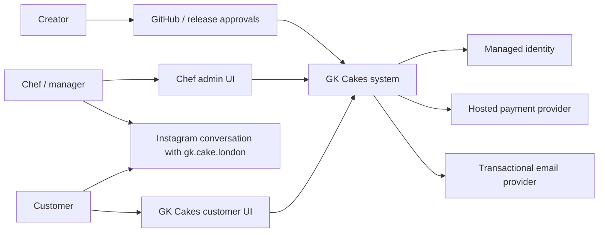
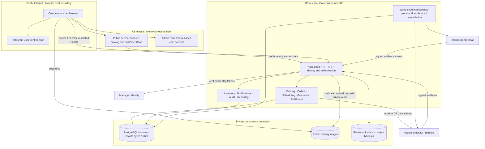

# Architecture — GK-019 r6; independent review pending

No application is implemented. [Inputs](input-revision.json), [provider evidence](provider-research.md)
and [shared vocabulary](shared-r1.md) define this proposal. One shop is a sizing
assumption, not a restriction silently imposed on the product. PostgreSQL is required.

## Decisions and boundaries

Go HTTP/SQL versus Django and UI choices were assessed by the qualified Astra commerce worker; Go API + SvelteKit Node shared customer/admin UI is technically accepted, with the GK-004 package accepted and separate paid activation gates. Options are recorded in [provider research](provider-research.md).
Recommend custom task-based chef UI sharing visual components with the customer
UI; public SSR uses only anonymous catalog APIs. Authenticated pages render a shell
then fetch private data with verified bearer identity; no shared cache of private
content and no tokens in URLs. Browser SDK bearer identity and current session checks follow K00; storage/CSP/revocation
must be qualified in GK-021 after GK-020 runtime bootstrap. Do not make the UI runtime a second
authoritative business backend. No browser database access, service keys, payment
secrets or direct writes to business tables.

Logical modules are ownership boundaries inside one backend, not deployed services.
All consequential transactions use the same database and authoritative domain
operations, including admin, webhook and job callers. Two release units: customer
and admin share the UI artifact; API and maintenance share the backend artifact.
Provider accounts remain Creator-owned. Customer support/recovery belongs to the
manager role; fulfillment staff cannot issue refunds or change roles.

## Operations and proposed budgets

Sizing fixture for later validation: 500 active products, 10,000 historical orders,
20 simultaneous readers and 5 simultaneous checkout attempts, one chef; measure
on chosen region/compute with realistic images. These are proposed test inputs,
not observed traffic. Public API p95 <=300ms, mutation local transaction p95 <=500ms,
order/dashboard page p95 <=1s excluding external providers; checkout responds with
pending operation within 3s rather than falsely reporting failure. Initial mobile
LCP target <=2.5s under agreed throttling and representative images; measure whole
page, not backend alone. Confirm budgets with Creator and provider sizing.

API proposal: 10s overall request deadline, DB transaction 2s lock/statement budget;
provider request 5s from a durable job, job lease 60s and heartbeat/fencing. Maximum
3 database conflict retries with jitter within caller deadline. Job attempts use
1m, 5m, 15m, 1h delays then manager attention; unknown money/email outcome never
means safe blind retry. Financial reconciliation remains discoverable even when
attempts exhaust. Five-minute cron cadence is a provisional detection budget;
alerts when oldest urgent operation exceeds 15m. No SLA claimed; missed cron and
large backlog require alerts and recoverable leases.

Current operations use [K08–K11](contracts.md): accepted3 support-hour routine
recovery target, zero confirmed-order/change/essential-attachment loss, independent
30d DB/object recovery snapshots, and explicit prepared/outcome records before
confirmation and external effects. GK-024 supplies the shared protocol before dependent money/free flows; GK-034/035 prove integrated backup/restore. B2 failure
pauses checkout; restoration freezes money/email dispatch until reconciled.
Current privacy retention is K09; raw provider payloads minimized to necessary
evidence and configured purge under GK-037 review, not an invented global7d purge.
GK-010 resource/role plan is provisioning evidence, not least-privilege/restore tests.

[Delivery](../planning/DELIVERY.md) governs PR checks/review, native auto-merge,
main CI, authorized published component releases, artifact digest, trusted main
ancestry, serialization, safe migration and counterpart compatibility. No production
push deploy hooks. Provider cost/restore tradeoffs remain explicit Creator gates.

Module specifications: [customer](features/customer.md), [commerce](features/commerce.md), [financial safety](features/financial-pilot.md), [operations](features/operations.md). Current shared contracts r6 settle gateway/lock/lifecycle/evidence interfaces; original packet recommendations are historical where reconciliation supersedes them.
