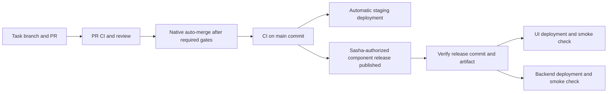

# Delivery contract

Current Creator decisions: [GK-006 interview-r1](../creator/GK-006/README.md),
approved 2026-10-05, establishes release
authority, review policy, component grouping/names and staging. Production remains
release-only; staging automatically deploys each merged revision after its main CI
passes. Independent specialist AI reviews loop through feedback/fixes and affected
rechecks before native auto-merge. Sasha alone authorizes production releases.
These decisions are not configured infrastructure; GitHub access/support remains
unverified and GK-013 must prove enforcement before enabling auto-merge.

Status: requested workflow and planning requirements. The kit supplies a basic
documentation/skill CI workflow only; GitHub settings and application CD are not
configured by this document. The stack and provider choices are accepted in ADR-0001/0002; GK-020 pins exact
versions and verifies commands, and GK-013 proves the required gates.

## Requested path

Ordinary branch pushes are needed for PRs. Interpret “push only on release creation”
as the accepted rule: **production deployments occur only for published releases**. Neither merge nor main CI deploys production.
Publishing a release is a separate authorized operation; auto-merge permission does
not grant release creation or arbitrary production access.

## CI and merge

1. Branches use `sasha-chycha/<task>` by default. Preserve existing staged/untracked
   work; stage only the implementation's changes. Work through a PR, never direct
   pushes to a protected/shared main branch.
2. Run fast formatting/lint/type/build checks and focused behaviour tests on PRs.
   Add relevant real-Postgres migration/constraint/concurrency checks; mocks are
   insufficient for reservation/refund races. Keep expensive unrelated work out
   of quick checks, but never skip required correctness checks.
3. Bootstrap tickets must establish exact supported toolchain/lockfiles and CI
   commands for the selected SvelteKit frontend and Go backend. Verify gofmt, go vet,
   tests/build, race checks, generated-query drift and vulnerability checks; pin
   frontend format/lint/type/build/test commands in GK-020. Do not add pass-through jobs that
   pretend application validation exists before source and tests do.
4. Configure main rules to require the selected CI checks and review policy.
   Revalidate changes against the merge base and dismiss stale approvals where
   supported. Enable GitHub's native auto-merge only after required gates exist.
   Verify repository plan/permissions support the chosen protections; if unavailable,
   record the blocker rather than bypassing the gates. Do not use a privileged
   ad-hoc bot to force a merge.
5. Run CI again on the resulting main commit. A red main commit blocks release,
   even if its PR was green. Auto-merge does not equal release acceptance.

The working routine for these steps, with the scripts that run them, is the
[implementation loop](DEV-LOOP.md).

GitHub's [native auto-merge](https://docs.github.com/en/pull-requests/how-tos/merge-and-close-pull-requests/automatically-merging-a-pull-request)
waits on the repository's required checks/reviews. If a merge queue is chosen,
the required workflows must also support its `merge_group` event.

## Separate releases and compatibility

Accepted GK-006 convention: `ui-vX.Y.Z` and `api-vX.Y.Z` tags identify immutable
commits and component artifacts. Customer/admin share the UI artifact; backend and
jobs share the API revision. Each component has its own production authorization.

- Trigger production CD on `release: published`; define prerelease/staging routing
  explicitly. Draft, deleted or edited releases must not accidentally deploy.
  Resolve the released tag to a commit, check trusted main ancestry and the required
  successful main-CI run **for that commit**, and select only the intended component.
- Build/reuse an immutable artifact from the verified commit, record its digest and
  deployment version, and never deploy whatever happens to be main at run time.
- UI and API pipelines have separate targets, environment permissions and release
  history. Contract compatibility must support the currently deployed counterpart.
  Use additive changes and expand/contract migrations for coordinated changes;
  document upgrade order and compatibility window rather than relying on simultaneity.
- Run backend migrations once in a controlled release step with a migration lock,
  appropriate database credentials and backup/restore evidence. Test old-to-new
  and empty-database paths. Do not run migrations independently on every replica.
- Serialize deployments per component/environment. Repeated release events are
  idempotent. Do not cancel a running migration or switch back to an older release
  accidentally because another release arrives.
- Define smoke checks, failure visibility, rollback to a compatible artifact and
  recovery if the migration prevents code rollback. Record which UI/API versions
  and schema are deployed; rollback is not a blind destructive down migration.

GitHub documents the release-published and merge-group triggers in
[workflow events](https://docs.github.com/en/actions/reference/workflows-and-actions/events-that-trigger-workflows).
The implementation must verify permissions, tag trust, event recursion and artifact
selection in a nonproduction environment before enabling production credentials.

## Secrets and operational ownership

Use protected environment secrets or provider workload identity where supported;
prefer short-lived deploy credentials. Restrict permissions per job/component and
separate sandbox/staging/production accounts or resources. Pin external Actions
to reviewed immutable commits. PR checks receive no production secrets; do not run
untrusted PR code in a privileged `pull_request_target` workflow.

Public frontend configuration contains only deliberately public values. Database,
storage-write, payment, email and webhook-signing secrets stay on the backend or
appropriate CI/deployment environment. Keep secret values out of Git, Trello,
screenshots, logs, build output and frontend bundles. Document names, purpose,
scope, storage location, owner, rotation and revocation; never values.

Creator setup covers accounts, MFA/recovery, billing limits, DNS and permission
grants. Implementation tickets cover config validation, least-privilege roles,
redaction and verified CI/CD. Use provider backup/monitoring facilities first;
record recovery targets and run a restore check before production acceptance.

## Evidence and Done

Record per ticket: acceptance checks, tested revision, review, related PRs, verified
merge, main CI and release/deployment/smoke evidence where that ticket includes them.
Planning complete, implementation accepted, merged and deployed are distinct states.
All related PRs and acceptance checks must be accounted for before an implementation
ticket can be accepted. Move Trello to Done only with the board's required approval;
do not infer approval from a green check. A release/deployment ticket additionally
requires the actual target/version and smoke result.
